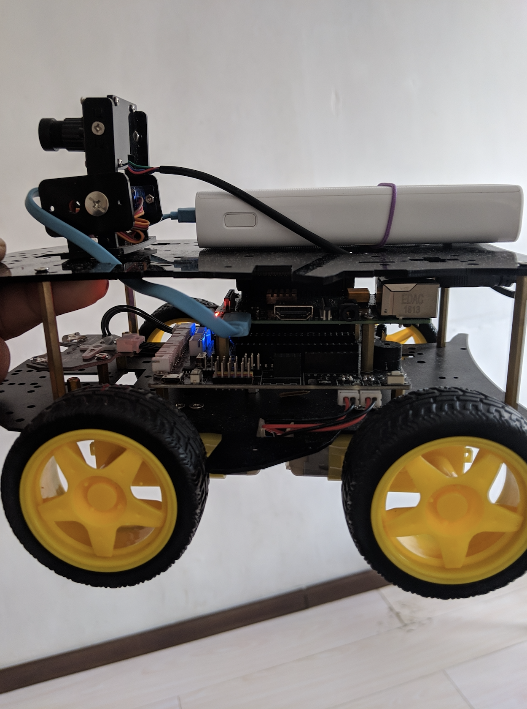
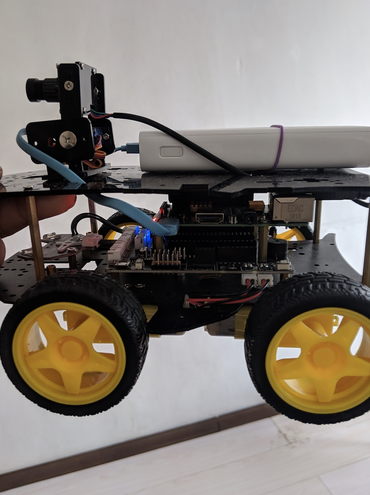

# Android things & Raspberry Pi & Car

## 更新 / Update

- 手机端 `app_mobile` 换上赛博朋克 2077 风格界面（连接 / 驾驶控制 / 全屏预览）。
  The mobile app now has a Cyberpunk 2077 style UI.
- 新增树莓派小车端 `car_pi`，从 Android Things 迁移到 Raspberry Pi。
  Added `car_pi` for the Raspberry Pi car.
- [手机端界面与使用说明](app_mobile/使用说明.md)

## License

    Copyright (C) 2019 zhenjin ma

    Licensed under the Apache License, Version 2.0 (the "License");
    you may not use this file except in compliance with the License.
    You may obtain a copy of the License at

       http://www.apache.org/licenses/LICENSE-2.0

    Unless required by applicable law or agreed to in writing, software
    distributed under the License is distributed on an "AS IS" BASIS,
    WITHOUT WARRANTIES OR CONDITIONS OF ANY KIND, either express or implied.
    See the License for the specific language governing permissions and
    limitations under the License.
